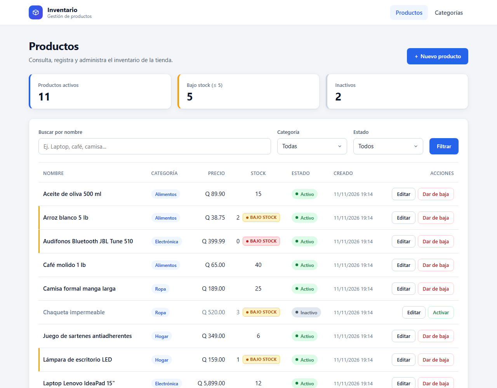
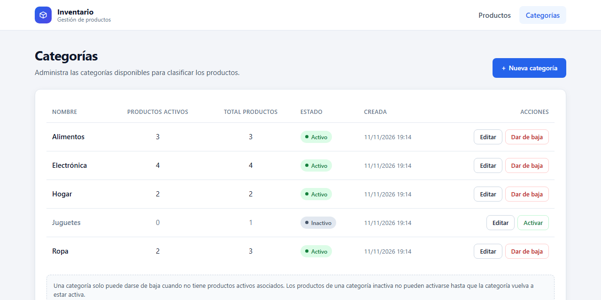
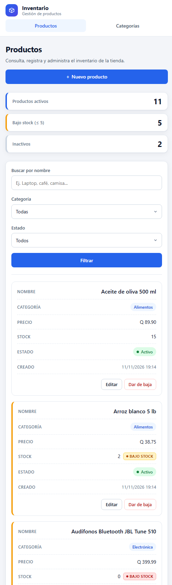
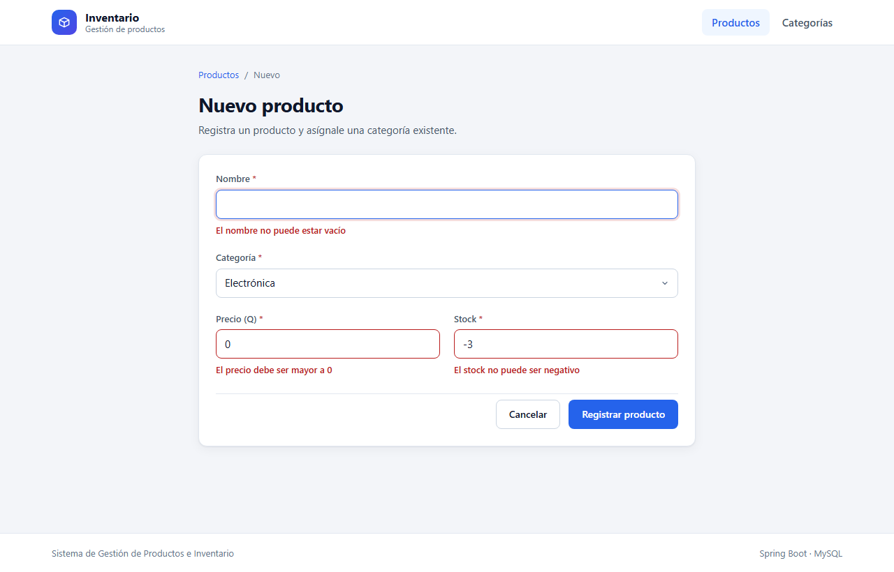

# Sistema de Gestión de Productos e Inventario

Aplicación web para el control de inventario de una tienda, desarrollada con **Java 17 + Spring Boot 3 + MySQL 8** y vistas **Thymeleaf** con **CSS propio** (Flexbox y CSS Grid, sin frameworks).



---

## Contenido

1. [Funcionalidades](#1-funcionalidades)
2. [Tecnologías y versiones](#2-tecnologías-y-versiones)
3. [Requisitos previos](#3-requisitos-previos)
4. [Pasos para levantar el proyecto en local](#4-pasos-para-levantar-el-proyecto-en-local)
5. [Importar la base de datos](#5-importar-la-base-de-datos)
6. [Configuración de credenciales](#6-configuración-de-credenciales)
7. [Ejecutar las pruebas](#7-ejecutar-las-pruebas)
8. [Estructura de carpetas y por qué se eligió](#8-estructura-de-carpetas-y-por-qué-se-eligió)
9. [Modelo de datos](#9-modelo-de-datos)
10. [Reglas de negocio](#10-reglas-de-negocio)
11. [Solución de problemas](#11-solución-de-problemas)

---

## 1. Funcionalidades

**Productos**
- Listado con nombre, categoría, precio, stock, estado y fecha de creación.
- Filtros combinables: búsqueda por nombre, filtro desplegable por categoría y filtro por estado (Todos, Activos, Inactivos).
- Indicadores de resumen: productos activos, productos con bajo stock y productos inactivos.
- Crear y modificar productos asignándoles una categoría existente.
- Validaciones: el nombre no puede estar vacío, el precio debe ser mayor a 0 y el stock no puede ser negativo (en el servidor y en la base de datos).
- Alerta visual **"Bajo Stock"** cuando el stock es menor o igual a 5 (amarilla) y en rojo cuando el producto está agotado.
- Dar de baja (cambia el estado a **Inactivo**) y volver a **Activar**.

**Categorías**
- Listado con cantidad de productos activos y totales por categoría.
- Crear y modificar categorías (no se permiten nombres duplicados).
- Dar de baja (estado **Inactivo**) y volver a **Activar**.
- No se permite dar de baja una categoría que todavía tiene productos activos asociados: la aplicación muestra un mensaje claro y no colapsa.

**Campo adicional `estado`**

Ambos maestros (`categorias` y `productos`) tienen la columna `estado` (`ACTIVO` / `INACTIVO`), así que cada uno tiene un ABC completo: **alta**, **cambios** y **baja lógica**. Los registros nunca se borran físicamente, por lo que siempre se pueden reactivar y se conserva el historial.

**Diseño**
- Interfaz limpia, con tipografía legible, espaciados consistentes y colores coherentes.
- Responsiva: en computadora se muestra una tabla y en tablet o teléfono se transforma en tarjetas.

---

## 2. Tecnologías y versiones

| Componente | Versión |
|---|---|
| Java (JDK) | **17 o superior** (probado con JDK 17 y 21) |
| Spring Boot | 3.5.14 (Web, Data JPA, Validation, Thymeleaf) |
| MySQL | **8.0 o superior** (probado con MySQL 8.4) |
| Maven | No hace falta instalarlo: se incluye **Maven Wrapper** (`mvnw` / `mvnw.cmd`), que descarga Maven 3.9 automáticamente |
| Frontend | HTML5 + Thymeleaf + CSS propio (Flexbox / Grid) |
| Pruebas | JUnit 5 + Mockito |

---

## 3. Requisitos previos

Solo se necesitan tres cosas instaladas:

1. **JDK 17 o superior.** Verifícalo con:
   ```bash
   java -version
   ```
   Debe mostrar `17` o un número mayor. Si no lo tienes, descarga Eclipse Temurin desde https://adoptium.net/ y marca la opción *Set JAVA_HOME* durante la instalación.

2. **MySQL Server 8.0 o superior** en ejecución. Verifícalo con:
   ```bash
   mysql --version
   ```
   Si el comando `mysql` no se reconoce en Windows, agrega `C:\Program Files\MySQL\MySQL Server 8.x\bin` al `PATH` o usa MySQL Workbench (ver la [opción B](#opción-b-mysql-workbench)).

3. **Git** para clonar el repositorio.

> No necesitas instalar Maven ni un IDE.

---

## 4. Pasos para levantar el proyecto en local

### Paso 1: clonar el repositorio

```bash
git clone https://github.com/brendaOviedo/Products.git
```

```bash
cd Products
```

### Paso 2: crear la base de datos

Importa el archivo `database.sql`, que está en la raíz del proyecto (detalle completo en la [sección 5](#5-importar-la-base-de-datos)):

```bash
mysql -u root -p -e "source database.sql"
```

### Paso 3: revisar las credenciales

Por defecto la aplicación se conecta a:

| Parámetro | Valor por defecto |
|---|---|
| Host | `localhost` |
| Puerto | `3306` |
| Base de datos | `inventario_db` |
| Usuario | `root` |
| Contraseña | `root` |

Si tu MySQL usa otra contraseña, sigue la [sección 6](#6-configuración-de-credenciales) antes de continuar.

### Paso 4: ejecutar la aplicación

**Windows (PowerShell o CMD):**
```powershell
.\mvnw.cmd spring-boot:run
```

**Linux / macOS:**
```bash
chmod +x mvnw
```
```bash
./mvnw spring-boot:run
```

La primera ejecución tarda unos minutos porque descarga Maven y las dependencias. La aplicación está lista cuando aparece en consola una línea como esta:

```
Started InventarioApplication in 5.3 seconds
```

### Paso 5: abrir la aplicación

Abre en el navegador: **http://localhost:8080**

Para detener la aplicación presiona `Ctrl + C` en la consola.

### Alternativa: generar el JAR y ejecutarlo

**Windows:**
```powershell
.\mvnw.cmd clean package
```
```powershell
java -jar target\inventario.jar
```

**Linux / macOS:**
```bash
./mvnw clean package
```
```bash
java -jar target/inventario.jar
```

---

## 5. Importar la base de datos

El archivo **`database.sql`** (en la raíz del proyecto) hace lo siguiente:

- Crea la base de datos `inventario_db` (UTF-8, `utf8mb4`).
- Crea las tablas `categorias` y `productos` con su relación 1 a N, llaves foráneas, restricciones `CHECK` e índices.
- Inserta datos de prueba: 5 categorías (una inactiva) y 13 productos, varios con bajo stock y algunos inactivos, para probar todas las reglas.

> El script elimina y vuelve a crear las tablas, así que puedes ejecutarlo de nuevo cuando quieras para regresar a los datos iniciales.

### Opción A: línea de comandos (Windows, Linux y macOS)

Desde la carpeta del proyecto:

```bash
mysql -u root -p -e "source database.sql"
```

Escribe la contraseña de tu usuario `root` cuando te la pida.

En Linux, macOS, CMD o Git Bash también funciona la redirección clásica (en PowerShell no, porque no admite `<`):

```bash
mysql -u root -p < database.sql
```

### Opción B: MySQL Workbench

1. Abre MySQL Workbench y conéctate a tu servidor local.
2. Menú **File → Open SQL Script...** y selecciona `database.sql`.
3. Ejecuta todo el script con el icono del rayo ⚡ (o `Ctrl + Shift + Enter`).
4. Actualiza el panel **Schemas**: debe aparecer `inventario_db`.

### Verificar la importación

```bash
mysql -u root -p -e "SELECT COUNT(*) AS categorias FROM inventario_db.categorias; SELECT COUNT(*) AS productos FROM inventario_db.productos;"
```

Debe devolver **5** categorías y **13** productos.

### (Opcional) Usuario dedicado en lugar de `root`

```sql
CREATE USER 'inventario'@'localhost' IDENTIFIED BY 'inventario123';
GRANT ALL PRIVILEGES ON inventario_db.* TO 'inventario'@'localhost';
FLUSH PRIVILEGES;
```

Luego ejecuta la aplicación con `DB_USER=inventario` y `DB_PASSWORD=inventario123` (ver la sección 6).

---

## 6. Configuración de credenciales

La conexión se define en `src/main/resources/application.properties` y se puede cambiar con **variables de entorno**, sin tocar el código:

| Variable | Descripción | Valor por defecto |
|---|---|---|
| `DB_HOST` | Servidor MySQL | `localhost` |
| `DB_PORT` | Puerto MySQL | `3306` |
| `DB_NAME` | Base de datos | `inventario_db` |
| `DB_USER` | Usuario | `root` |
| `DB_PASSWORD` | Contraseña | `root` |
| `SERVER_PORT` | Puerto de la aplicación web | `8080` |

Ejemplo con la contraseña `MiClave123`:

**PowerShell:**
```powershell
$env:DB_PASSWORD="MiClave123"; .\mvnw.cmd spring-boot:run
```

**CMD:**
```cmd
set "DB_PASSWORD=MiClave123" && mvnw.cmd spring-boot:run
```

**Linux / macOS:**
```bash
DB_PASSWORD=MiClave123 ./mvnw spring-boot:run
```

También puedes editar el valor por defecto directamente en `application.properties`:

```properties
spring.datasource.password=${DB_PASSWORD:MiClave123}
```

---

## 7. Ejecutar las pruebas

Las pruebas unitarias validan las reglas de negocio (bajo stock, no dar de baja categorías con productos activos, no activar productos de categorías inactivas, nombres duplicados, etc.) y **no necesitan base de datos**:

**Windows:**
```powershell
.\mvnw.cmd test
```

**Linux / macOS:**
```bash
./mvnw test
```

---

## 8. Estructura de carpetas y por qué se eligió

```
Products/
├── database.sql                      Estructura de tablas y datos de prueba
├── pom.xml                           Dependencias y build (Maven)
├── mvnw / mvnw.cmd / .mvn/           Maven Wrapper (no requiere instalar Maven)
├── docs/capturas/                    Imágenes usadas en este README
└── src/
    ├── main/
    │   ├── java/com/ssm/inventario/
    │   │   ├── InventarioApplication.java   Punto de entrada de Spring Boot
    │   │   ├── controller/                  Capa web: recibe peticiones y elige la vista
    │   │   │   ├── ProductoController.java
    │   │   │   ├── CategoriaController.java
    │   │   │   ├── InicioController.java
    │   │   │   └── ManejadorErrores.java    Manejo global de errores (404, BD, 500)
    │   │   ├── service/                     Lógica y reglas de negocio
    │   │   │   ├── ProductoService.java
    │   │   │   └── CategoriaService.java
    │   │   ├── repository/                  Acceso a datos (Spring Data JPA)
    │   │   ├── model/                       Entidades JPA: Producto, Categoria, Estado
    │   │   ├── dto/                         Objetos de formulario y de resumen para las vistas
    │   │   └── exception/                   Excepciones de negocio
    │   └── resources/
    │       ├── application.properties       Configuración (BD, puerto, etc.)
    │       ├── templates/                   Vistas Thymeleaf, agrupadas por módulo
    │       │   ├── fragments/layout.html    Encabezado, menú, alertas y pie reutilizables
    │       │   ├── productos/               lista.html, formulario.html
    │       │   ├── categorias/              lista.html, formulario.html
    │       │   └── error.html
    │       └── static/
    │           ├── css/styles.css           Estilos propios (Flexbox, Grid, responsive)
    │           └── js/app.js                Confirmación al dar de baja
    └── test/java/com/ssm/inventario/service/   Pruebas unitarias de las reglas de negocio
```

**¿Por qué esta estructura?**

- **Arquitectura en capas (Controller → Service → Repository → Model):** es el estándar en Spring Boot y separa responsabilidades. Los controladores solo manejan HTTP y vistas, los servicios concentran las reglas de negocio y los repositorios solo acceden a datos. Así cada parte se entiende, se prueba y se cambia por separado; por ejemplo, las reglas de negocio se prueban sin base de datos.
- **Paquetes por tipo de componente:** para un proyecto de este tamaño (dos entidades) es la organización más fácil de recorrer para quien revisa el código: toda la lógica está en `service/` y todas las rutas en `controller/`.
- **DTOs separados de las entidades:** los formularios (`ProductoForm`, `CategoriaForm`) no exponen la entidad JPA directamente. Así el usuario no puede modificar campos que no debe (como `estado` o `fecha_creacion`) y las validaciones de la vista quedan aisladas.
- **Plantillas agrupadas por módulo y fragmentos reutilizables:** `templates/productos` y `templates/categorias` reflejan las rutas `/productos` y `/categorias`, y `fragments/layout.html` evita repetir el menú, las alertas y el pie en cada página.
- **`static/` para CSS y JS propios:** Spring Boot los sirve automáticamente, sin configuración extra.
- **`database.sql` en la raíz:** es lo que pide el enunciado y es lo primero que busca quien levanta el proyecto. La aplicación usa `ddl-auto=validate`, así que al arrancar verifica que la estructura de la base coincide con las entidades, pero nunca la modifica.

---

## 9. Modelo de datos

```
┌──────────────────────────┐          ┌──────────────────────────────┐
│ categorias               │          │ productos                    │
├──────────────────────────┤          ├──────────────────────────────┤
│ id             PK  AI    │ 1      N │ id              PK  AI       │
│ nombre         UNIQUE    │◄─────────┤ categoria_id    FK           │
│ estado         ACTIVO /  │          │ nombre          NOT NULL     │
│                INACTIVO  │          │ precio          DECIMAL > 0  │
│ fecha_creacion DATETIME  │          │ stock           INT >= 0     │
└──────────────────────────┘          │ estado          ACTIVO /     │
                                      │                 INACTIVO     │
                                      │ fecha_creacion  DATETIME     │
                                      └──────────────────────────────┘
```

- La llave foránea usa `ON DELETE RESTRICT`: aun si alguien intentara borrar una categoría directamente en la base de datos, MySQL lo impediría mientras tenga productos.
- Las restricciones `CHECK` (precio > 0, stock >= 0, nombre no vacío, estado válido) refuerzan en la base de datos las mismas validaciones que hace la aplicación.

---

## 10. Reglas de negocio

| Regla | Comportamiento |
|---|---|
| Bajo stock | Si `stock <= 5` se muestra la etiqueta **"Bajo Stock"** en amarillo; si `stock = 0`, en rojo. La fila o tarjeta se resalta con un borde lateral. |
| Validaciones del producto | El nombre no puede estar vacío, el precio debe ser mayor a 0 y el stock no puede ser negativo. Los errores se muestran junto a cada campo. |
| Baja de categoría | Solo se puede dar de baja (inactivar) si **no tiene productos activos**. Si los tiene, se muestra un mensaje indicando cuántos son y la aplicación sigue funcionando. |
| Baja de producto | Cambia el estado a `INACTIVO`; el registro se conserva y se puede reactivar. |
| Reactivar producto | Solo se permite si su categoría está activa (si no, se pide activar la categoría o asignarle otra). |
| Nuevos productos | Solo se pueden asignar a categorías activas. |
| Nombres de categoría | No se permiten duplicados (sin distinguir mayúsculas y minúsculas). |
| Errores inesperados | Se muestra una página de error amigable (404, error de base de datos o 500) en lugar de la página técnica del servidor. |

---

## 11. Solución de problemas

| Problema | Solución |
|---|---|
| `Access denied for user 'root'@'localhost'` | La contraseña de MySQL no es `root`. Configura `DB_PASSWORD` (sección 6). |
| `Unknown database 'inventario_db'` | No se importó `database.sql`. Repite la sección 5. |
| `Schema-validation: missing table` o `missing column` | La base existe pero con otra estructura. Vuelve a ejecutar `database.sql`. |
| `Communications link failure` | MySQL no está en ejecución o está en otro puerto. Inicia el servicio o configura `DB_PORT`. En Windows: `services.msc` → *MySQL80* → Iniciar. |
| `Port 8080 was already in use` | Otro programa usa el puerto. Ejecuta con otro puerto, por ejemplo `$env:SERVER_PORT="8090"` (PowerShell) o `SERVER_PORT=8090 ./mvnw spring-boot:run`, y abre http://localhost:8090 |
| `JAVA_HOME is not set` o una versión de Java menor a 17 | Instala JDK 17+ y define `JAVA_HOME` apuntando a la carpeta del JDK. |
| `./mvnw: Permission denied` (Linux/macOS) | Ejecuta `chmod +x mvnw`. |
| `mysql` no se reconoce como comando | Usa MySQL Workbench (opción B) o agrega la carpeta `bin` de MySQL al `PATH`. |

---

## Capturas

| Escritorio | Teléfono |
|---|---|
|  |  |


